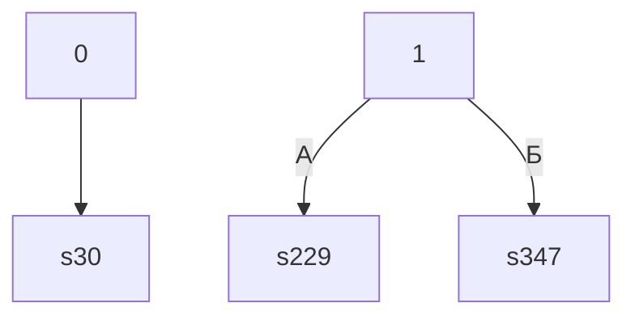

# Карта ветвлений: `storyGraph.md`

> Часть инструкции QuestRules. Точка входа — [AGENTS.md](../AGENTS.md).

### 2.3. storyGraph.md — карта ветвлений

Производный документ: генерируется при разборе, вручную не правится. Источник истины —
`story.md` + `game.yaml`; `storyGraph.md` нужен, чтобы видеть структуру книги целиком:
где развилки, куда ведут варианты, какие сцены недостижимы.

**Состав:**

```markdown
# storyGraph.md

Сцен: 350. Переходов: 517. Выборов: 112. Бросков: 23. Концовок: 5. Недостижимых: 8.

## Ветвления

| Сцена | Тип | Выходы |
|---|---|---|
| 1 | выбор | А → 229; Б → 347 |
| 5 | бросок | 1d6: ≥4 → 343; иначе → 342 |
| 7 | линейный | 94 |

## Концовки

| Сцена | Входящих |
|---|---|
| 162 | 0 |

## Развилки (3+)

| Сцена | Выходов |
|---|---|
| 93 | 3 |

## Хабы (топ-10 по входящим)

| Сцена | Входящих |
|---|---|

## Недостижимые

132, 154, 162, …

## Граф


```

**Правила:**

- каждая сцена попадает ровно в одну строку таблицы ветвлений: линейная, выбор,
  бросок или концовка;
- выходы выбора подписаны буквами `А`, `Б`, `В` — как в `story.md`;
- у броска подписаны условия исходов (`≥4`, `иначе`);
- концовки перечислены отдельно, с числом входящих переходов;
- недостижимые сцены перечислены явно — это кандидаты на удаление или на проверку
  ссылок книги;
- Mermaid-граф строится по тем же рёбрам; он не заменяет таблицу, а показывает форму
  истории: циклы, развилки, тупики;
- файл детерминированный: один и тот же пакет даёт одинаковый `storyGraph.md`.

**Фрагмент.** Если `status: fragment`, граф строится только по найденным секциям, а в
шапке появляется строка `Фрагмент: ссылки за границу — N`. Такие ссылки не считаются
ошибкой, но перечисляются отдельной таблицей, чтобы человек видел, где обрывается
книга.

**Недостижимые из-за динамического перехода.** Бывает, что часть параграфов достижима
только «знанием»: «обратитесь к параграфу с тем же номером, что и число на ключе».
Формат такой переход не выражает, поэтому в графе такие сцены законно недостижимы.
Их нельзя молча удалять или пришивать: в разделе «Недостижимые» они группируются с
причиной (какая сцена ведёт к ним динамически) и уходят в `review.md` как
`C_DYNAMIC_LINK`. На ZombieBlood так вышло 15 сцен из 402 — вместе с единственной
удачной концовкой; это повод для решения человека, а не для правки графа.

**Крупные книги.** Для 400–600 сцен таблицы ветвлений и хабов остаются читаемыми, но
Mermaid-граф на такое число узлов не строится: вместо него — список развилок и
концовок, а полный граф выгружается отдельным файлом (`storyGraph.full.mmd`) по
запросу.

**Концовки без маркера.** Листовая сцена без ссылок — всегда концовка: в манифесте
ставится `ending: true`. Финальность проверяется по тексту: если есть финальная фраза
(«конец», «ваше приключение закончено», «вы погибли»), развязка по смыслу («молодец,
тебе удалось выжить», «Похоже, ты проиграл..») или книга прямо называет сцену
финалом, этого достаточно; многоточие в конце — интонация, а не обрыв книги. Если
финала нет ни по фразе, ни по смыслу, сцена всё равно остаётся концовкой (текст книги
обрывается), но случай идёт в `review.md` как `C_SCENE_DEAD_END` — это вопрос к
человеку, а не ошибка графа. В «Недостижимые» такая сцена попадает только по графу:
если из `start` к ней нет пути.

**Задел на будущее.** Если историю понадобится разрезать на несколько файлов,
добавляется `scenes/*.md` с той же конвенцией заголовков (TBD 2). Меняется только
источник файлов, а модель и синтаксис остаются прежними.

**Осталось открытым:** лимиты на размер пакета, изображения и звука — TBD 8, TBD 10.

---
